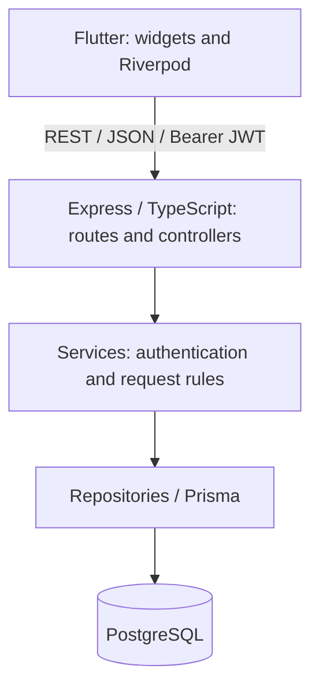

# Architecture

## Structure

The app and API share a repository and one contract. A single backend keeps authentication, profiles and reviews together; microservices would add deployment and consistency work without a need for independent services.

## Flutter

`lib/features` groups authentication, profile, requests and HR review. `lib/core` holds HTTP, session handling, routing, theme and shared widgets. Repositories serialize requests and parse responses outside widgets.

Riverpod manages sessions, queries and create/review actions. Mutations invalidate affected queries; review conflicts reload the server's decision. Session/operation guards block stale results after logout, a new session or controller disposal. Pagination resets after local mutations and recovers when refresh removes the last page.

Dio centralizes the base URL, Bearer header, timeouts and error conversion. go_router handles session loading, sign-in redirects and role navigation. Routing is a UX guard; the backend authorizes access. This keeps networking and asynchronous state out of widgets without extra domain/use-case layers.

## Backend and database

Requests follow route → controller → service → repository → Prisma/PostgreSQL. Controllers validate HTTP input and shape responses; services enforce business rules; repositories own queries and transactions. Middleware handles authentication, roles, logging, CORS, Helmet and errors. The profile route reuses the authenticated safe user.

PostgreSQL provides relational ownership/reviewer links, foreign keys, unique user identifiers, enums and transactions. Prisma supplies typed queries and versioned migrations. Timestamps are server-assigned ISO dates, displayed in local time by Flutter.

`HRRequest.employeeId` references the internal `User.id` UUID; `User.employeeId` is the displayed business identifier. Queries project safe employee/reviewer fields without password hashes. Composite indexes support employee/status filters and `submittedAt, id` ordering. Bounded lists read the page and count in a repeatable-read transaction for consistent metadata.

## Authentication and security

Users are predefined; the development seed supplies two employees and one HR account with bcrypt-hashed passwords. Login issues an HS256 JWT with issuer, audience and expiry, defaulting to one hour. Bearer authentication validates the token and loads the current database user and role.

Flutter stores JWTs through flutter_secure_storage and validates restored sessions with `GET /api/me`. Logout deletes the local token without server-side revocation; there is no refresh-token flow. A 401 clears the session, but stale responses cannot sign out a newer login. Temporary restoration failures preserve the token and offer retry/sign-out.

Authentication identifies the caller; role and ownership checks authorize access. Employee routes require EMPLOYEE and scope queries to the authenticated UUID. Missing and private employee resources return the same 404. HR routes require HR.

Strict Zod schemas validate types, IDs, queries, lengths and NUL text, and reject unknown fields. The server assigns ownership, initial status and timestamps; HR supplies only a decision and optional comment. Reviewer identity comes from authentication. Errors expose stable codes without database details or stacks. Logs omit credentials, tokens, descriptions and HR comments. Helmet, exact CORS origins and process-local login rate limiting provide HTTP protections.

## Concurrent review

A transaction updates a request only where its ID matches and its status is PENDING. If no row changes, it distinguishes a missing request from a completed review. One competing review succeeds; the other receives 409. Completed decisions cannot be overwritten through the API. The client reloads detail and pending state on conflict.

## Tests

1. Backend API/integration tests use real PostgreSQL and cover authentication, authorization, validation, ownership, concurrent review and safe errors/logging.
2. Flutter unit/widget/state tests cover captured contracts, session races, routing, forms, invalidation, pagination and responsive failure states.
3. The opt-in Windows runner tests production Dio/repositories/Riverpod → real HTTP → Express → Prisma → isolated PostgreSQL. It separates backend-test data and cleans up afterward. Only host token storage is simulated.

Android/iOS compilation and device storage/networking still need native verification.

## Beyond 100,000 employees

This scale has not been load-tested. These are proposed deployment/design changes:

- **Database:** measure queries with EXPLAIN and tune indexes for actual filters. Replace deep OFFSET pagination with keyset pagination when needed. Budget connection pools across instances; consider managed PostgreSQL and read replicas where measured load justifies their consistency costs.
- **Backend:** run stateless instances behind a load balancer with trusted proxies configured correctly. Replace process-local login limiting with a shared store. Centralize configuration, secrets, metrics, tracing, logs and alerts.
- **Caching:** cache measured read-heavy workloads with ownership-aware keys and explicit invalidation. Keep private HR data out of shared caches unless access controls are preserved.
- **Background work:** use a queue for slow/retryable notifications or document generation if those features are added.
- **Security and operations:** add TLS, managed secrets, backups/recovery checks and monitoring. Enterprise requirements may need SSO/IAM and a durable audit trail beyond current review logs. Independent services would need a measured reason.
